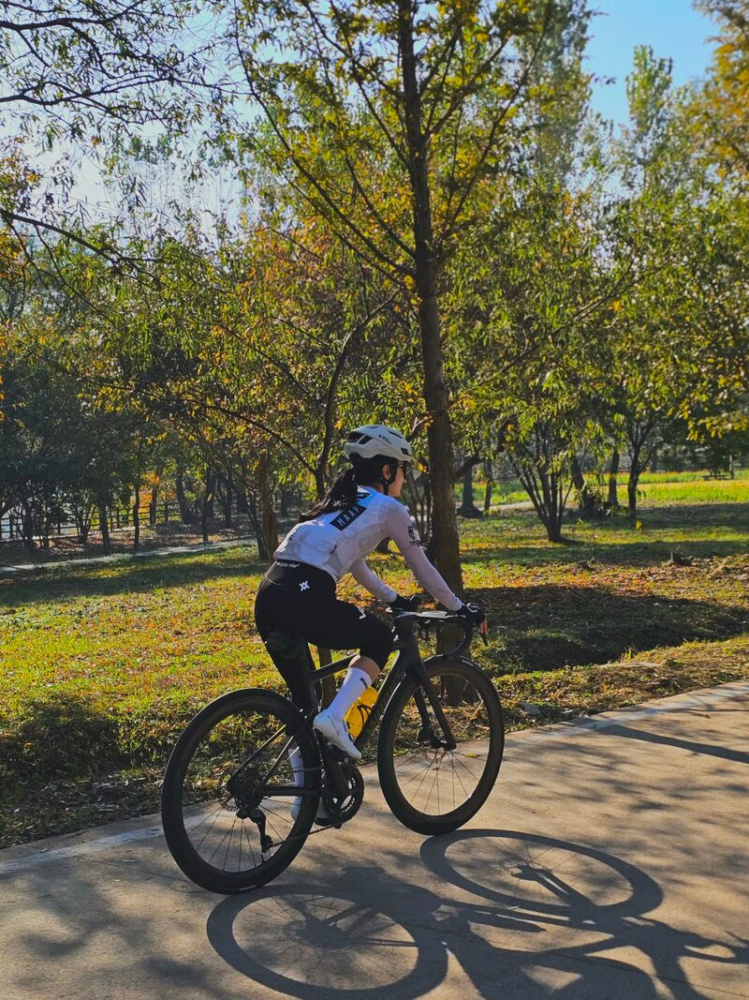
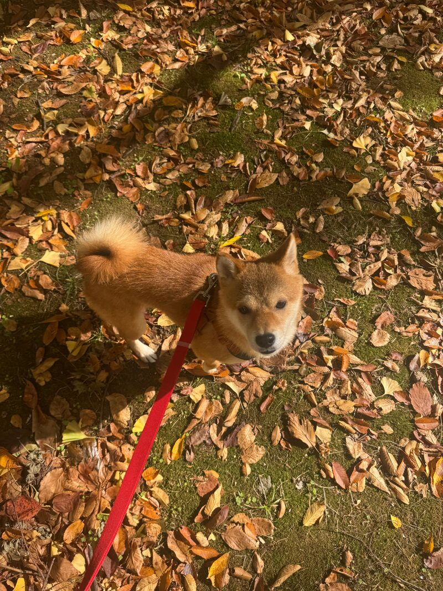

I am a first-semester M.S. student in the Department of Library and Information Science at Yonsei University, working in the [SNIS Lab](https://snis.yonsei.ac.kr/) (Prof. Ji-Hong Park).

My research interests are **Human-AI interaction**, **quantitative analysis**, and **ESG**. I am interested in how people evaluate and rely on information produced by AI systems, and in how quantitative and text-analytic methods can make complex financial and ESG information easier to understand and trust.

Background
======
Before graduate school, I spent about nine years in finance. At Korea Investment & Securities, I worked on retirement-pension asset management, real-estate investment trusts, and corporate and investment-asset analysis. At the Seoul National University Development Foundation, I supported endowment management and financial reporting.

Since 2020, I have been a researcher at ResearchNLP, where I collect, clean, and analyze unstructured text data (including web crawling for a Korea Labor Institute project) and turn the results into visualizations and reports.

Recently, I have been designing and building AI-assisted web services end to end, from problem definition and data design to the user interface. See the [Portfolio](/portfolio/) for examples.

Education
======
* **M.S. in Library and Information Science**, Yonsei University, 2026 – present
* **B.A. in English Language and Literature** (Minor: Public Administration), Ewha Womans University, 2008

Research Interests
======
* Human-AI interaction and trust in AI-generated information
* Quantitative analysis and text mining (TF-IDF, Word2Vec, LDA)
* ESG and financial information services

Contact
======
* Email: [clovis1023@yonsei.ac.kr](mailto:clovis1023@yonsei.ac.kr)
* SNIS Lab, Department of Library and Information Science, Yonsei University, Seoul, Korea

Beyond Research
======
Outside the lab, I love road cycling, especially long autumn rides through the mountains. I also spend a lot of time walking my mame shiba, Bamtol (밤톨, "little chestnut").

  
  

