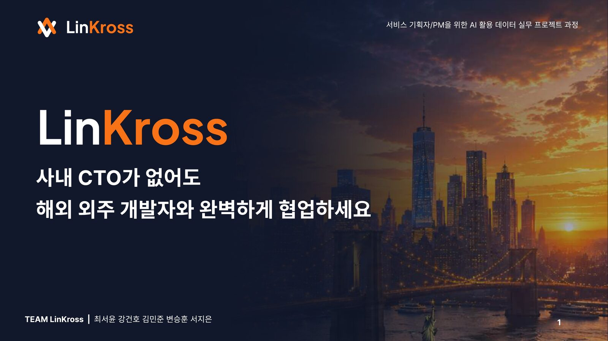
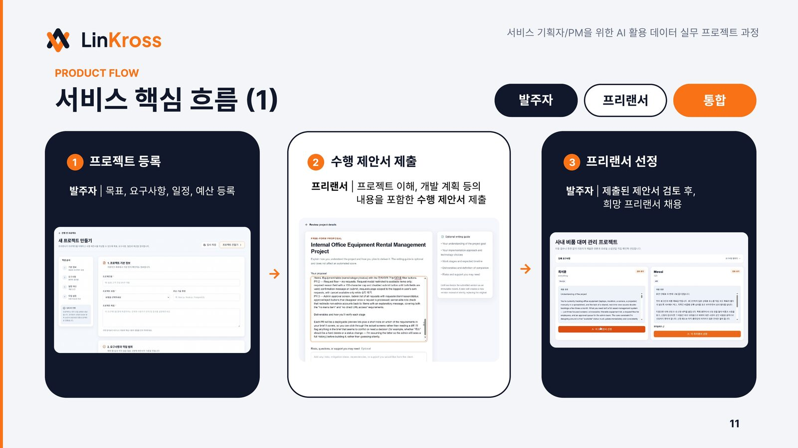
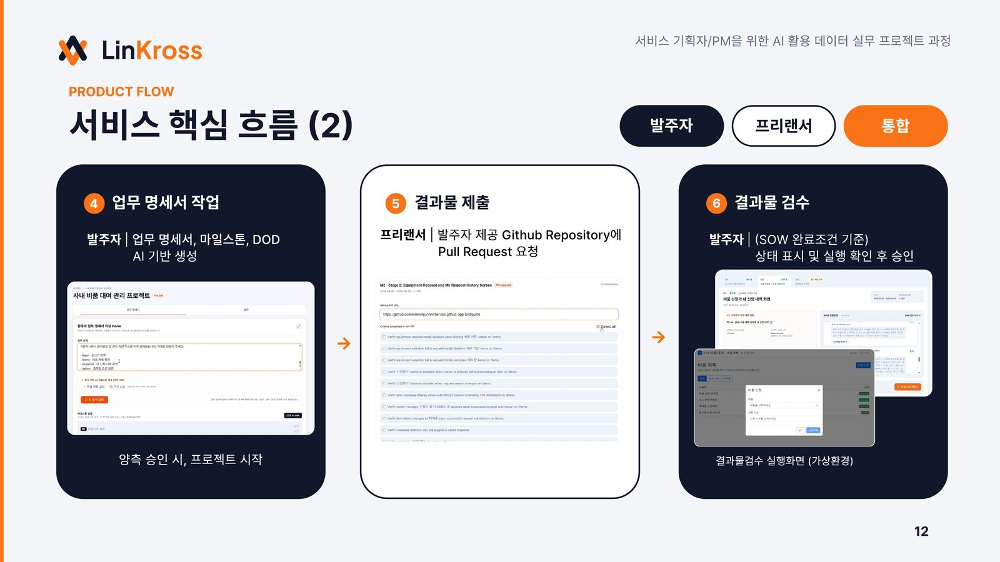
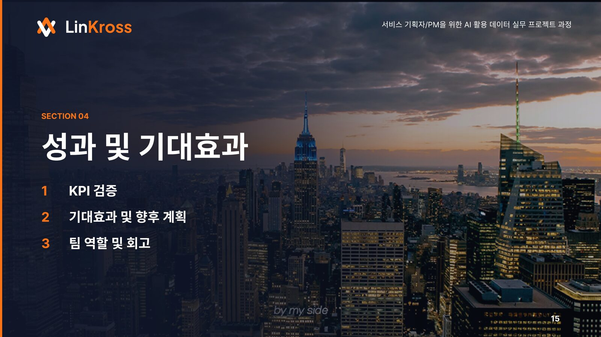

**Period:** 2026  
**Team project (5 members)** · SeSAC "AI-Driven Data Project Course for Service Planners/PMs"  
**My role:** UI/UX and freelancer-experience design  
**Code:** [github.com/kimminjunnn/LinKross](https://github.com/kimminjunnn/LinKross)

Problem
------
Generative AI makes it fast to start building, but a prototype is not a working MVP. Early-stage founders often cannot afford an in-house development team, and overseas outsourcing is cheaper but risky at every stage: choosing a developer, agreeing on requirements, managing the schedule, checking deliverables, and paying.

Solution
------
LinKross ("Link + Cross") connects clients with overseas freelancers and manages the whole collaboration in one structure: **select → agree → manage → verify → pay**.

Key features:
* **LLM-generated milestones and Definitions of Done (DoD):** natural-language requirements become milestones and verifiable completion conditions.
* **RAG-based English specifications:** a glossary-based RAG translates Korean requirements into English specs that keep Korean IT context.
* **Semi-automated deliverable verification:** submitted code (GitHub commit SHA) is run in a Vercel Sandbox and checked with Playwright against the agreed DoD.
* **Milestone-based invoicing and payment records**, with test-net USDC payments.

Results
------
Measured on three sample projects:
* **91.4%** of requirements (53/58) were converted into verifiable DoD conditions.
* **0 omissions** of core conditions in English translation (37/37 preserved).

My contribution
------
* Client landing page and side-by-side comparison of applicants
* Freelancer dashboard and marketplace
* English localization of freelancer-facing screens
* Overall UI refinement and logo design

**Tech stack:** Next.js, TypeScript, Gemini, Supabase (PostgreSQL), GitHub App, Vercel Sandbox, Playwright, Base Sepolia (test-net USDC)
